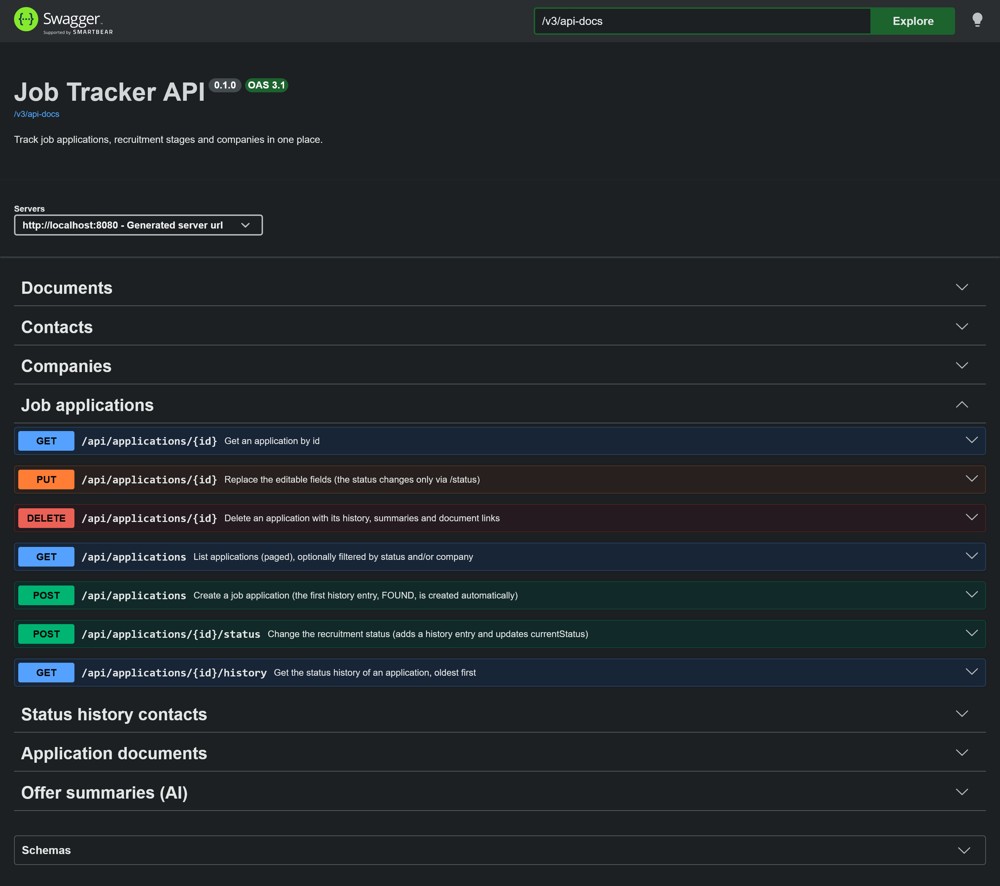
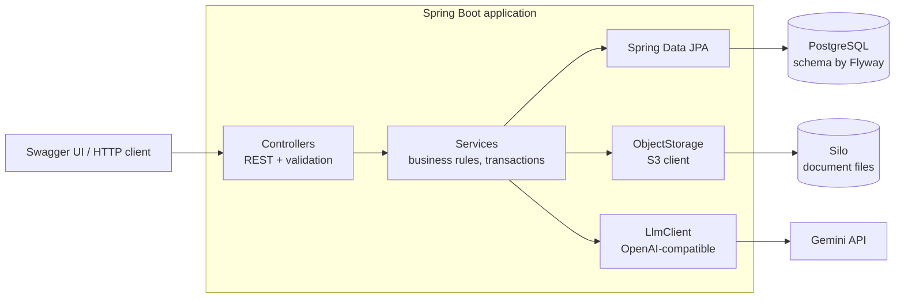
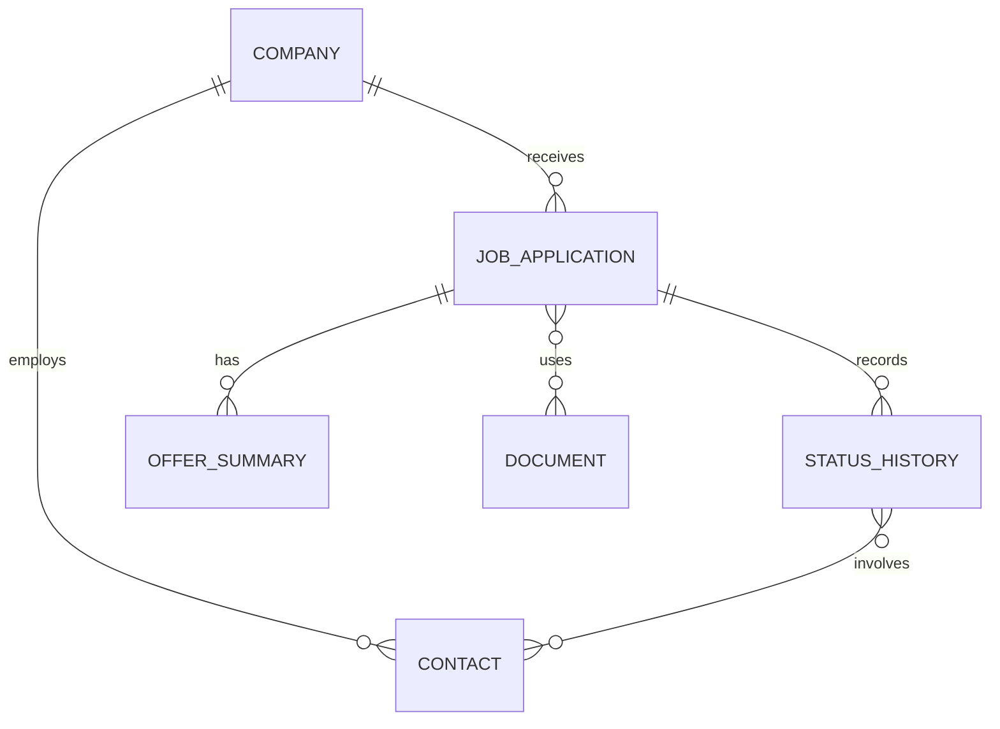

# Job Tracker


A REST API that keeps your whole job search in one place: the offers you applied to, the CV and cover letter you
sent, every recruitment stage, the people you talked to, and an AI-generated summary of each job offer.

A portfolio project built to practice production-style backend development with Java, Spring Boot, PostgreSQL,
Docker and CI.



## Features

- Companies and job applications with filtering, sorting and paging
- Recruitment pipeline with an immutable status history (`FOUND → APPLIED → … → OFFER_RECEIVED → ACCEPTED / REJECTED`)
- Contacts (recruiters, interviewers) linked to the exact stages they took part in
- Documents (CVs, cover letters) with real file upload to S3-compatible storage, attachable to applications
- AI summary of a pasted job description, with automatic fallback to a second model
- OpenAPI documentation with Swagger UI

## Tech stack

Java 25 · Spring Boot 4.1 (Web MVC, Data JPA, Validation) · PostgreSQL 17 + Flyway · Silo (S3-compatible storage) ·
springdoc-openapi · Gemini via an OpenAI-compatible client · JUnit 5, Mockito, Testcontainers ·
Maven, Docker Compose, GitHub Actions

## Architecture

Package-by-feature, classic layers (controller → service → repository), records as DTOs.





Postgres stores metadata (including the object key of each file); file contents live in S3 storage.

## API overview

All endpoints live under `/api`; full request/response details are in Swagger UI.

| Resource | Endpoints |
| --- | --- |
| Companies | `POST/GET /companies`, `GET/PUT/DELETE /companies/{id}` |
| Applications | `POST/GET /applications`, `GET/PUT/DELETE /applications/{id}`, `POST /applications/{id}/status`, `GET /applications/{id}/history` |
| Contacts | `POST/GET /contacts`, `GET/PUT/DELETE /contacts/{id}`, `PUT/DELETE /applications/{id}/history/{entryId}/contacts/{contactId}` |
| Documents | `POST/GET /documents`, `POST /documents/upload`, `GET/PUT/DELETE /documents/{id}`, `GET /documents/{id}/file` |
| Application documents | `GET /applications/{id}/documents`, `PUT/DELETE /applications/{id}/documents/{documentId}` |
| AI summaries | `POST/GET /applications/{id}/summaries`, `GET /applications/{id}/summaries/latest` |

## Quick start

Requires Docker with Compose.

```bash
cp .env.example .env          # optional: set GEMINI_API_KEY
docker compose up --build
```

| Service | URL |
| --- | --- |
| Swagger UI | http://localhost:8080/swagger-ui/index.html |
| Silo console | http://localhost:9001 (`minioadmin` / `minioadmin`, local use only) |

Flyway migrations run automatically on startup. A free Gemini key is available in
[Google AI Studio](https://aistudio.google.com/); without it, everything works except the AI summaries
(those endpoints return `503`). Stop with `docker compose down` (add `-v` to also delete data).

Example file upload:

```bash
curl -X POST http://localhost:8080/api/documents/upload \
  -F "file=@CV.pdf" -F "type=CV" -F "name=CV Java Backend"
```

## Configuration

Defaults work with the provided `docker-compose.yml`; override them with environment variables or `.env`.

| Variable | Default | Purpose |
| --- | --- | --- |
| `DB_URL`, `DB_USER`, `DB_PASSWORD` | `localhost`, `jobtracker`, `jobtracker` | PostgreSQL connection |
| `S3_ENDPOINT`, `S3_ACCESS_KEY`, `S3_SECRET_KEY`, `S3_BUCKET`, `S3_REGION` | local Silo defaults | S3-compatible storage |
| `GEMINI_API_KEY` | none | AI provider key |
| `GEMINI_MODEL`, `GEMINI_FALLBACK_MODEL` | see `application.yml` | Primary model and fallback for 429/5xx |

Both the AI client (OpenAI protocol) and the storage layer (S3 protocol) are provider-agnostic: switching provider is
a configuration change.

## Development

```bash
docker compose up -d db minio     # infrastructure only
./mvnw spring-boot:run            # or .\mvnw.cmd spring-boot:run on Windows
./mvnw verify                     # tests; Docker must be running
```

Integration tests run against a throwaway PostgreSQL container (Testcontainers), never against the development
database, and the LLM is replaced by a fake, so no API key is needed.

## CI/CD

GitHub Actions builds and tests every push to `main` and every pull request (`./mvnw verify`), builds the Docker
image, and publishes it to GitHub Container Registry on `main`. Dependabot proposes weekly dependency updates.

## Roadmap

Authentication (Spring Security + JWT) · statistics (funnel, time between stages, CV effectiveness) · reminders ·
importing job-alert e-mails as suggested offers · online demo

## License

MIT, see `LICENSE`.