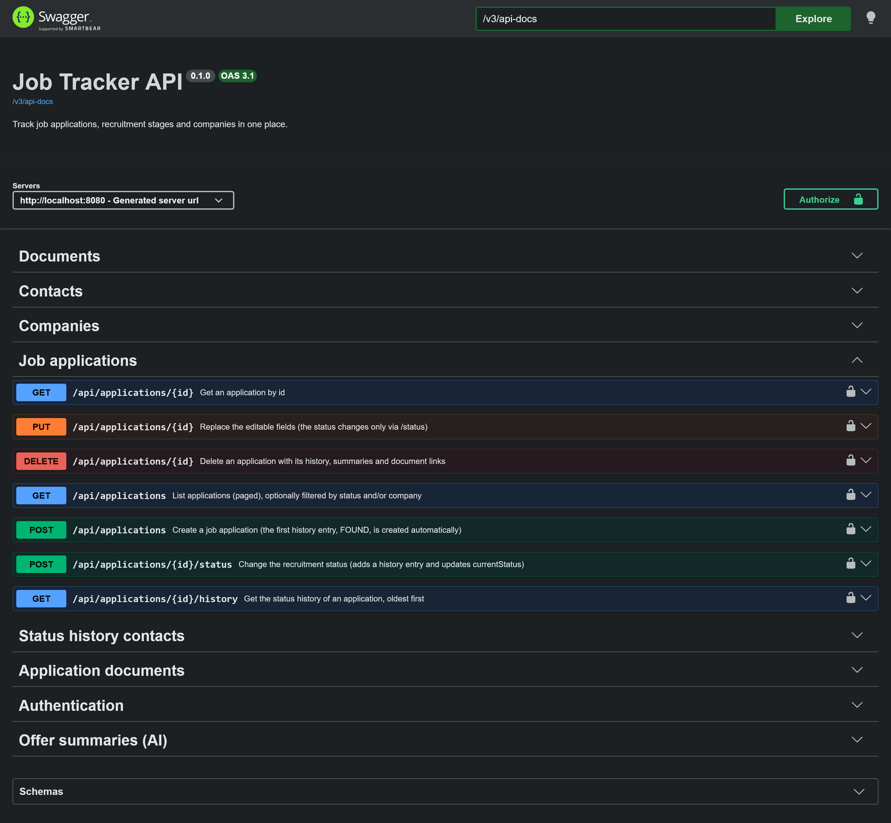
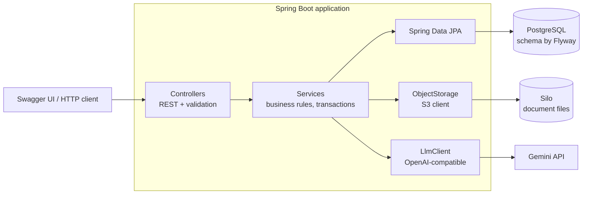
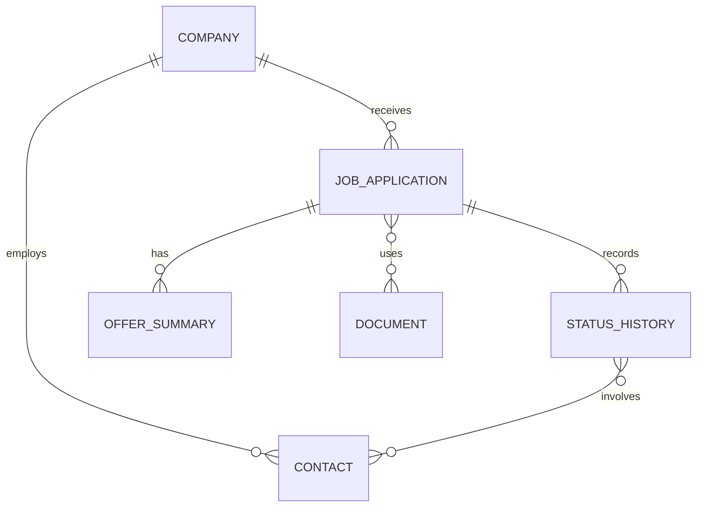
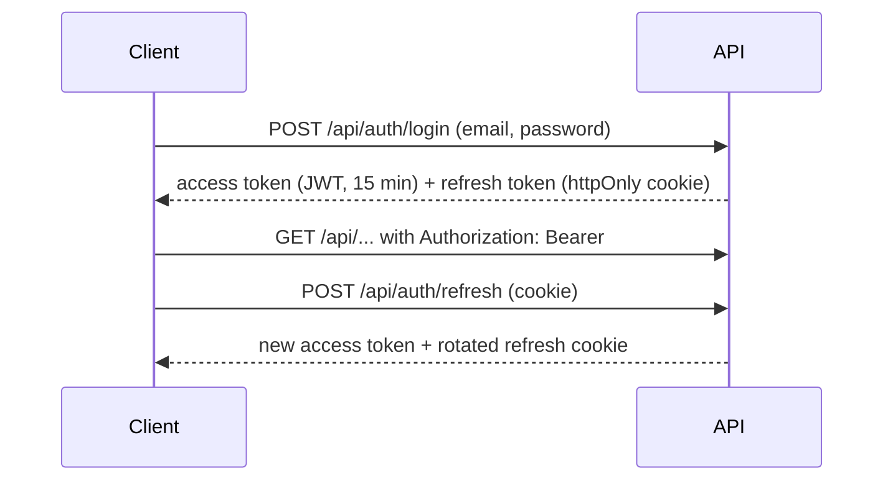

# Job Tracker


[](/LICENSE)

A REST API that keeps your whole job search in one place: the offers you applied to, the CV and cover letter you
sent, every recruitment stage, the people you talked to, and an AI-generated summary of each job offer.



## Features

- Companies and job applications with filtering, sorting and paging
- "Today" dashboard: applications that need attention (deadline soon, no response, not applied yet), upcoming next
  steps, active applications per status and recent activity, in one call
- A planned next step (interview, task, follow-up) on each application
- Recruitment pipeline with a correctable status history (`FOUND → APPLIED → … → OFFER_RECEIVED → ACCEPTED / REJECTED`)
- Contacts (recruiters, interviewers) linked to the exact stages they took part in
- Documents (CVs, cover letters) with real file upload to S3-compatible storage, attachable to applications
- AI summary of a pasted job description, with automatic fallback to a second model
- Authentication with short-lived JWT access tokens and rotating refresh tokens; read-only demo mode
- OpenAPI documentation with Swagger UI

## Tech stack

Java 25 · Spring Boot 4.1 (Web MVC, Data JPA, Validation, Security) · PostgreSQL 17 + Flyway ·
Silo (S3-compatible storage) · springdoc-openapi · Gemini via an OpenAI-compatible client ·
JUnit 5, Mockito, Testcontainers · Maven, Docker Compose, GitHub Actions

## Architecture

Package-by-feature, classic layers (controller → service → repository), records as DTOs.





Postgres stores metadata (including the object key of each file); file contents live in S3 storage.

## Security



- Stateless API secured with Spring Security (OAuth2 resource server, HS256 JWT with a pinned algorithm).
- Passwords are hashed with BCrypt; login errors are generic and take comparable time for unknown users.
- Refresh tokens are random, stored only as SHA-256 hashes, rotated on every use, and reuse of a consumed token
  revokes the whole session. The cookie is `httpOnly`, `SameSite=Strict` and scoped to `/api/auth`.
- Roles: `ADMIN` can do everything, `DEMO` is read-only. Errors use the same RFC 9457 format as the rest of the API.
- There is a single owner account, created on first start from environment variables (no registration).

## API overview

All endpoints live under `/api` and require `Authorization: Bearer <token>` except the ones under `/api/auth`.
Full request/response details are in Swagger UI.

| Resource | Endpoints |
| --- | --- |
| Authentication | `POST /auth/login`, `POST /auth/refresh`, `POST /auth/logout` |
| Companies | `POST/GET /companies`, `GET /companies/lookup?q=…&limit=…` (autocomplete), `GET/PUT/DELETE /companies/{id}` |
| Account | `GET /auth/me`, `POST /auth/change-password` |
| Dashboard | `GET /dashboard` |
| Applications | `POST/GET /applications`, `GET/PUT/DELETE /applications/{id}`, `POST /applications/{id}/status`, `POST /applications/{id}/apply`, `GET /applications/{id}/history`, `PUT /applications/{id}/notes`, `POST /applications/{id}/archive`, `POST /applications/{id}/unarchive` |
| Contacts | `POST/GET /contacts`, `GET/PUT/DELETE /contacts/{id}`, `PUT/DELETE /applications/{id}/history/{entryId}/contacts/{contactId}` |
| Status history corrections | `PUT/DELETE /applications/{id}/history/{entryId}` |
| Documents | `POST/GET /documents`, `POST /documents/upload`, `GET/PUT/DELETE /documents/{id}`, `GET /documents/{id}/file` |
| Application documents | `GET /applications/{id}/documents`, `PUT/DELETE /applications/{id}/documents/{documentId}` |
| AI summaries | `POST/GET /applications/{id}/summaries`, `GET /applications/{id}/summaries/latest` |

The application list (`GET /applications`) combines its filters with AND: free-text `q`, `companyId`, `status`
(repeatable), `active`, `archived`, `staleDays`, `deadlineWithinDays` and more, and it can be sorted by
`lastStatusChangedAt`. `active=true` means not archived and the process still open; `GHOSTED` counts as finished
there, although a late reply can still move it on in the history.

## Quick start

Requires Docker with Compose.

```bash
cp .env.example .env
```

Edit `.env` and set at least:

- `JWT_SECRET`: at least 32 random bytes, for example `openssl rand -base64 48`
- `APP_ADMIN_EMAIL` and `APP_ADMIN_PASSWORD` (at least 12 characters): the owner account, created on first start
- optionally `GEMINI_API_KEY`: a free key from [Google AI Studio](https://aistudio.google.com/)

```bash
docker compose up --build
```

| Service | URL |
| --- | --- |
| Swagger UI | http://localhost:8080/swagger-ui/index.html |
| Silo console | http://localhost:9001 (`minioadmin` / `minioadmin`, local use only) |

In Swagger UI call `POST /api/auth/login`, click **Authorize** and paste the returned `accessToken` (without the
`Bearer ` prefix). Flyway migrations run automatically on startup. Without a Gemini key everything works except the
AI summaries (those endpoints return `503`). Stop with `docker compose down` (add `-v` to also delete data).

Example file upload:

```bash
curl -X POST http://localhost:8080/api/documents/upload \
  -H "Authorization: Bearer <accessToken>" \
  -F "file=@CV.pdf" -F "type=CV" -F "name=CV Java Backend"
```

## Demo mode

A dedicated, read-only instance with fictional sample data and a public demo account (no owner account, no AI key):

```bash
docker compose -p jobtracker-demo -f docker-compose.yml -f docker-compose.demo.yml up --build
```

Log in with `demo@job-tracker.example` / `demo-readonly-pass`. The `DEMO` role can read everything and modify
nothing. Demo mode refuses to start next to an owner account, because the application has no per-user data
isolation and the demo user would see the owner's data.

## Configuration

Defaults work with the provided `docker-compose.yml`; override them with environment variables or `.env`.

| Variable | Default | Purpose |
| --- | --- | --- |
| `APP_TIMEZONE` | `Europe/Warsaw`| Time zone for dates and "today" (ISO 8601 zone id) |
| `JWT_SECRET` | none (required) | Signing key for access tokens, at least 32 bytes |
| `APP_ADMIN_EMAIL`, `APP_ADMIN_PASSWORD` | none | Owner account created when the user table is empty |
| `APP_ADMIN_RESET_PASSWORD` | `false` | If `true`, account password will be reset to `APP_ADMIN_PASSWORD` on next login |
| `COOKIE_SECURE` | `false` in Compose | Set to `true` behind HTTPS so the refresh cookie is sent only over TLS |
| `APP_DEMO_ENABLED` | `false` | Demo mode (see above) |
| `DB_URL`, `DB_USER`, `DB_PASSWORD` | `localhost`, `jobtracker`, `jobtracker` | PostgreSQL connection |
| `S3_ENDPOINT`, `S3_ACCESS_KEY`, `S3_SECRET_KEY`, `S3_BUCKET`, `S3_REGION` | local Silo defaults | S3-compatible storage |
| `GEMINI_API_KEY` | none | AI provider key |
| `GEMINI_MODEL`, `GEMINI_FALLBACK_MODEL` | see `application.yml` | Primary model and fallback for 429/5xx |
| `APP_DASHBOARD_STALE_DAYS`, `APP_DASHBOARD_DEADLINE_DAYS`, `APP_DASHBOARD_LIMIT` | `14`, `7`, `10` | Dashboard thresholds: days without response, days until a deadline, items per list |

Both the AI client (OpenAI protocol) and the storage layer (S3 protocol) are provider-agnostic: switching provider is
a configuration change.

## Development

```bash
docker compose up -d db minio     # infrastructure only
cd backend
./mvnw spring-boot:run            # or .\mvnw.cmd spring-boot:run on Windows
./mvnw verify                     # tests; Docker must be running
```

When running from an IDE, set `JWT_SECRET`, `APP_ADMIN_EMAIL` and `APP_ADMIN_PASSWORD` as environment variables.

Integration tests run against a throwaway PostgreSQL container (Testcontainers), never against the development
database, with their own test configuration (no secrets needed), and the LLM is replaced by a fake.

## CI/CD

GitHub Actions builds and tests every push to `main` and every pull request (`cd backend && ./mvnw verify`), builds
the Docker image, and publishes it to GitHub Container Registry on `main`. Dependabot proposes weekly dependency updates.

## Design decisions

- **Flyway owns the schema**; `ddl-auto: validate` fails fast on any entity/migration mismatch.
- **Status history is the source of truth**; `currentStatus` is a denormalized column updated in the same transaction.
  `lastStatusChangedAt` is not stored at all: it is derived from the history with a subquery, so it cannot drift.
- **Metadata in the database, bytes in S3**, behind an `ObjectStorage` abstraction. Documents attached to
  applications cannot be deleted, only archived.
- **Authorization lives in one place**: URL rules by HTTP method (read for any role, write for `ADMIN`).
- **AI is used for one narrow task.** The job posting is passed as delimited data and the model is told to ignore any
  instructions inside it; the model call happens outside any database transaction.

## Roadmap

React + TypeScript frontend · statistics (funnel, time between stages, CV effectiveness) · reminders ·
importing job-alert e-mails as suggested offers · per-user data isolation · hosted demo

## License

GPL v3, see [LICENSE](/LICENSE).
